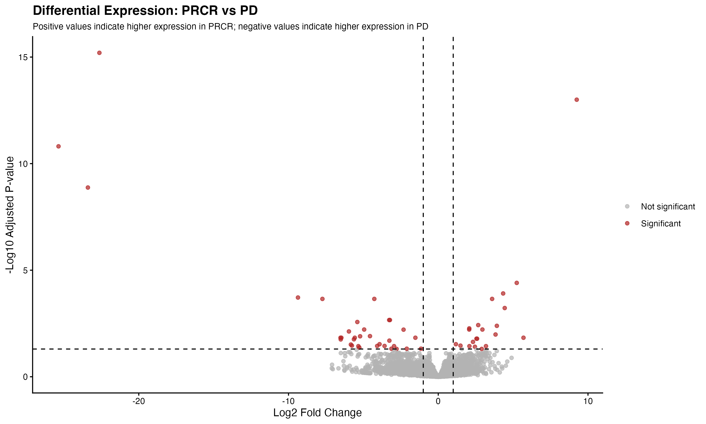
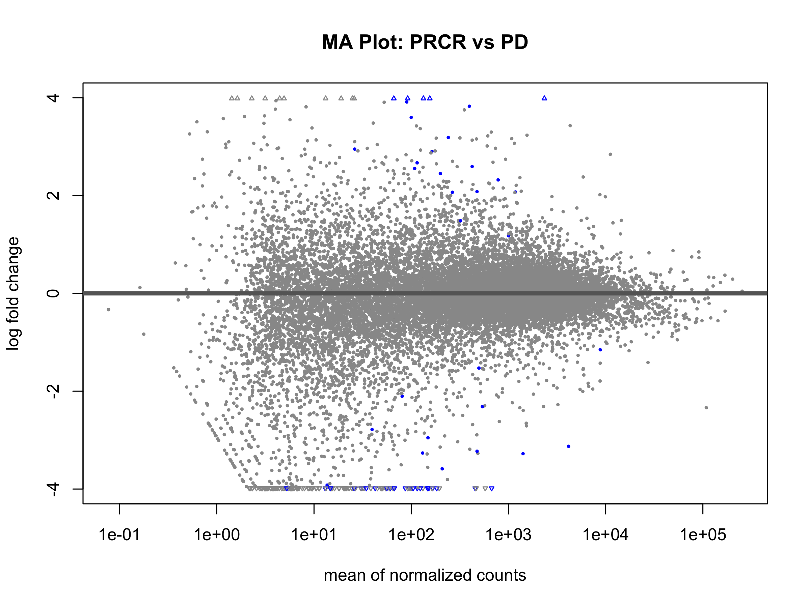
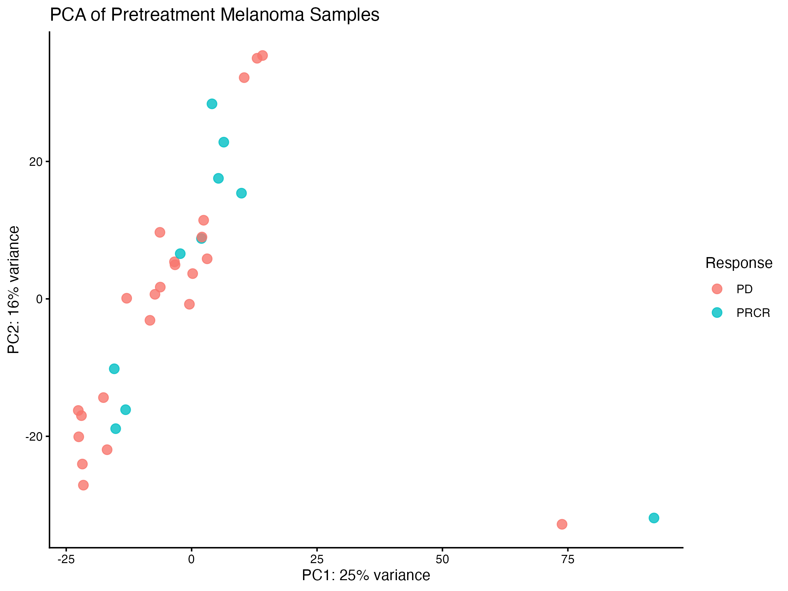
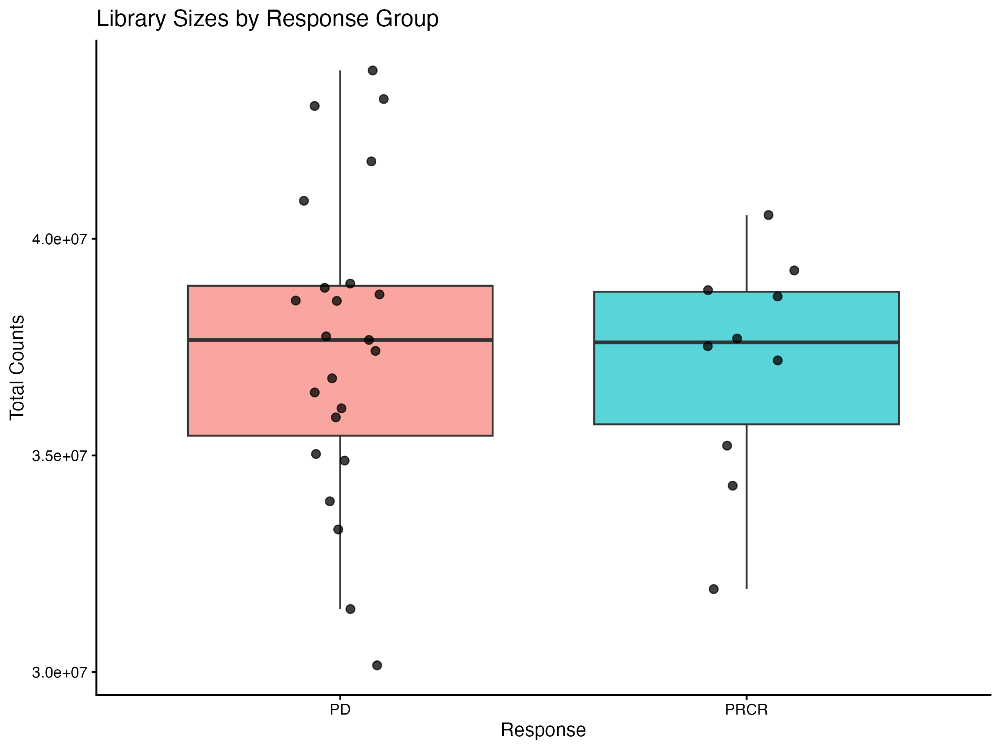
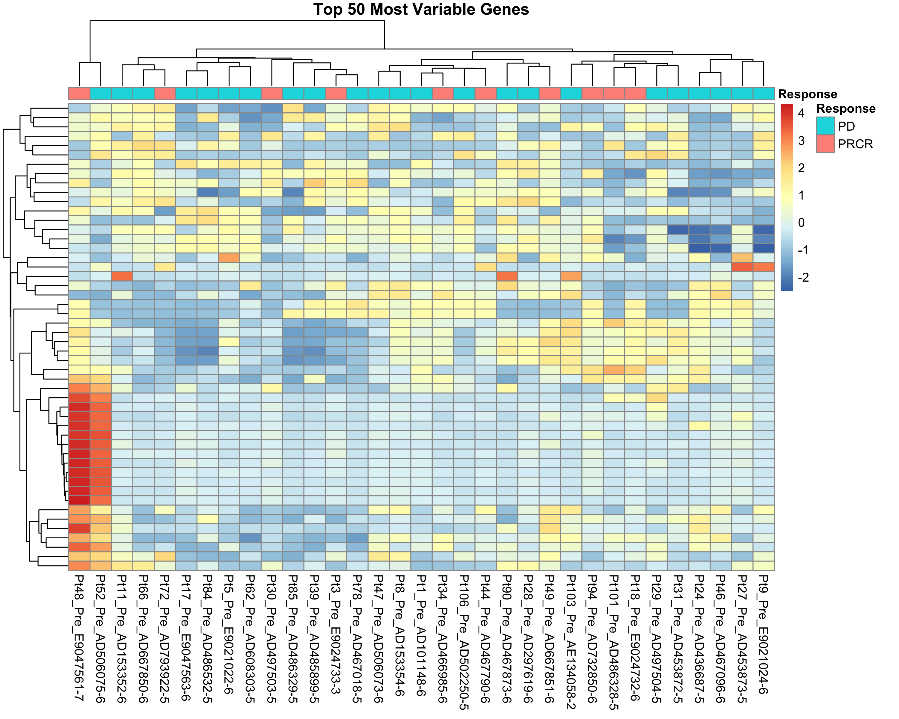
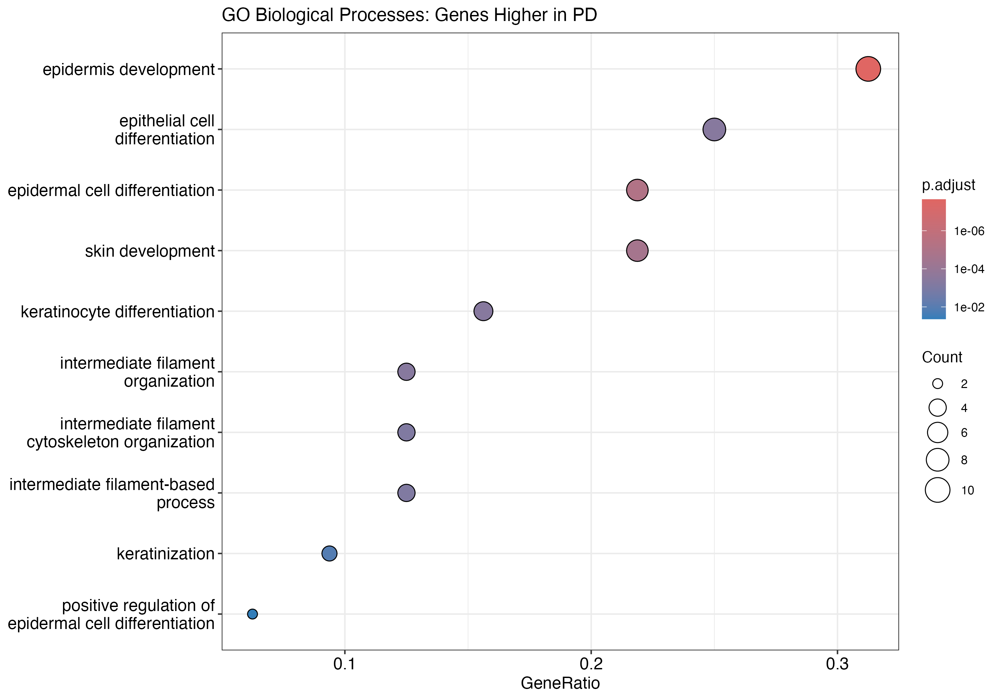

# RNA-seq Differential Expression & Pathway Analysis

## Biological Question

Can gene expression differences help distinguish melanoma patients who experienced progressive disease (PD) from those who responded to nivolumab treatment with a partial or complete response (PRCR)?

This project uses RNA-seq data from melanoma patients to identify genes associated with treatment response and investigate the biological processes represented by those genes.

## About the Project

For this project, I built an RNA-seq differential expression analysis workflow in R using DESeq2. I worked with pretreatment gene expression data from patients with different clinical outcomes following nivolumab treatment.

The analysis covers data preparation, gene filtering, differential expression testing, gene annotation, visualization, and Gene Ontology (GO) biological process enrichment. I also generated figures to examine sample-level patterns and interpret the results.

The main goal was to practice a reproducible bioinformatics workflow while connecting statistical results to their potential biological significance.

## Dataset and Data Source

The dataset comes from the Gene Expression Omnibus (GEO):

- **GEO accession:** [GSE91061](https://www.ncbi.nlm.nih.gov/geo/query/acc.cgi?acc=GSE91061)
- **Treatment:** Nivolumab, an immune checkpoint inhibitor
- **Disease:** Melanoma
- **Samples analyzed:** 33 pretreatment samples
- **Progressive disease (PD):** 23 samples
- **Partial or complete response (PRCR):** 10 samples

I focused on pretreatment samples to examine gene expression differences associated with the patients' subsequent clinical outcomes.

The raw expression data file used by the analysis is `GSE91061_BMS038109Sample.hg19KnownGene.raw.csv.gz`. Raw input data is excluded from the GitHub repository and must be placed in the expected local directory before running the analysis.

## Analysis

### 1. Data Preparation and Filtering

I loaded the raw gene expression counts and prepared the sample response information for differential expression analysis.

To remove genes with very low expression, I retained genes with counts of at least 10 in at least 3 samples. This filtering step left **18,737 genes** for downstream analysis.

### 2. Differential Expression Analysis

I used DESeq2 to compare gene expression between the two clinical outcome groups, with response included as the experimental design variable.

The comparison was set up as `PRCR vs PD`. Therefore:

- **Positive log2 fold change:** Higher expression in PRCR.
- **Negative log2 fold change:** Higher expression in PD.

Genes were considered significantly differentially expressed when they met both of the following criteria:

- Adjusted p-value (`padj`) below 0.05.
- Absolute log2 fold change of at least 1.

The adjusted p-values account for multiple hypothesis testing across the genes analyzed.

### 3. Gene Annotation

I used `org.Hs.eg.db` and `AnnotationDbi` to add gene symbols and gene names to the significant gene results. This makes the results easier to interpret than relying on gene identifiers alone.

### 4. Visualization

I generated several figures to examine the results from different perspectives:

- **Library sizes:** Compare the total number of reads across samples.
- **Volcano plot:** Show the relationship between expression fold change and statistical significance.
- **MA plot:** Examine average expression in relation to fold change.
- **Principal component analysis (PCA):** Explore overall expression patterns and variation between samples.
- **Top variable genes heatmap:** Compare expression patterns among the 50 most variable genes.
- **GO biological process dot plot:** Visualize enriched biological processes among genes with higher expression in PD.

### 5. Gene Ontology Enrichment

I used `clusterProfiler` to perform Gene Ontology Biological Process (GO BP) enrichment analysis separately for genes with higher expression in PD and genes with higher expression in PRCR.

The enrichment analysis used the filtered genes retained for differential expression testing as the background universe. I used Benjamini–Hochberg multiple-testing correction and an adjusted significance threshold of 0.05 for the enrichment p-value cutoff, with a q-value cutoff of 0.20.

Analyzing the two gene sets separately allowed me to investigate whether either response group was associated with particular biological processes.

## Differential Expression Results

Using the selected significance criteria, the analysis identified **54 significantly differentially expressed genes**.

| Result | Number of genes |
|---|---:|
| Total genes tested after filtering | 18,737 |
| Significant genes | 54 |
| Higher expression in PD | 33 |
| Higher expression in PRCR | 21 |

These results represent genes associated with the difference between the two clinical outcome groups in this dataset. They do not establish that the expression differences caused the treatment outcomes.

## Biological Process Enrichment Results

The GO BP analysis identified **10 enriched biological process terms** for genes with higher expression in PD. No terms passed the selected enrichment criteria for genes with higher expression in PRCR.

The enriched terms were primarily related to epidermis and skin development, keratinocyte differentiation, and keratinization.

These findings suggest that the genes identified in the PD group may be associated with skin-related biological processes. However, enrichment results describe patterns within the selected gene set and should be interpreted cautiously, particularly given the relatively small number of significant genes.

## Main Findings

- The analysis identified 54 significantly differentially expressed genes between the PD and PRCR groups.
- Of these genes, 33 had higher expression in PD and 21 had higher expression in PRCR.
- GO BP enrichment identified 10 terms for the PD-associated gene set, primarily involving epidermal development, keratinocyte differentiation, and keratinization.
- No GO BP terms passed the selected enrichment criteria for the PRCR-associated gene set.
- PCA showed variation among samples without a clear separation between the two response groups based on the first two principal components.

Overall, the analysis identified a small set of genes associated with clinical response and biological process enrichment in the PD group. These findings provide a starting point for further investigation rather than definitive evidence of a treatment-response mechanism.

## Visualizations

### Volcano Plot

The volcano plot displays differential expression results using log2 fold change and adjusted p-values. It highlights genes that meet the selected statistical and fold-change criteria.



### MA Plot

The MA plot shows the relationship between average gene expression and estimated log2 fold change.



### Principal Component Analysis

PCA provides an overview of sample-level expression variation. The first two principal components explained approximately 25% and 16% of the variance, respectively. The samples did not form clearly separated groups based on clinical response.



### Library Sizes

This figure compares library sizes across the samples included in the analysis.



### Top Variable Genes

The heatmap compares expression patterns across samples for the 50 most variable genes.



### GO Biological Process Enrichment

The dot plot summarizes enriched GO biological process terms for genes with higher expression in the PD group.



## Limitations

- The analysis includes 33 pretreatment samples, with 23 in the PD group and 10 in the PRCR group. The relatively small sample size may limit statistical power and the generalizability of the results.
- Differential expression identifies associations between gene expression and clinical outcome; it does not demonstrate causation.
- PCA did not show clear separation between the response groups using the first two principal components.
- GO enrichment results depend on the genes selected for analysis, the background gene universe, and the statistical thresholds used.
- The absence of enriched GO BP terms for genes higher in PRCR does not prove that no relevant biological processes exist. It means that no terms passed the criteria used in this analysis.
- The findings would require further investigation and independent validation before being considered potential biomarkers or predictors of treatment response.

## Technologies

- **R** — Statistical analysis and workflow development
- **DESeq2** — RNA-seq differential expression analysis
- **GEOquery** — Retrieval of GEO dataset metadata
- **AnnotationDbi** and **org.Hs.eg.db** — Gene annotation
- **clusterProfiler** — GO enrichment analysis
- **enrichplot** — Enrichment visualization
- **ggplot2** — Data visualization
- **pheatmap** — Heatmap generation
- **RStudio / R projects** — Project organization and analysis

## Project Structure

```text
RNAseq-Differential-Expression/
├── Figures/
│   ├── GO_BP_higher_in_PD.png
│   ├── library_sizes_by_response.png
│   ├── ma_plot.png
│   ├── pca_response.png
│   ├── top_variable_genes_heatmap.png
│   └── volcano_plot.png
├── Results/
│   ├── all_differential_expression_results.csv
│   ├── differential_expression_annotated.csv
│   ├── genes_higher_in_PD.csv
│   ├── genes_higher_in_PRCR.csv
│   ├── GO_BP_higher_in_PD.csv
│   ├── GO_BP_higher_in_PRCR.csv
│   ├── session_info.txt
│   ├── significant_genes.csv
│   └── significant_genes_annotated.csv
├── Scripts/
│   └── rnaseq_differential_expression.R
├── Data/
│   └── Raw/
│       └── GSE91061_BMS038109Sample.hg19KnownGene.raw.csv.gz
├── .gitignore
├── RNAseq-Differential-Expression.Rproj
└── README.md
```

*Note: The raw data file is required locally but is excluded from GitHub. The `Data/Raw/` directory may need to be created after cloning the repository.*

## Running the Analysis

1. Clone or download the repository.
2. Install R and the required packages listed in the Technologies section.
3. Download or obtain the raw expression file and place it at `Data/Raw/GSE91061_BMS038109Sample.hg19KnownGene.raw.csv.gz`.
4. Open `RNAseq-Differential-Expression.Rproj` in RStudio.
5. Open and run `Scripts/rnaseq_differential_expression.R`.

The script currently contains a local project-directory path that must be updated to match the location of the repository on another computer before running it. The analysis also retrieves GEO metadata through `GEOquery`, so an internet connection is required for that step.

## What I Practiced

Through this project, I gained experience with:

- Preparing RNA-seq count data for differential expression analysis.
- Filtering low-count genes and setting up a DESeq2 experimental design.
- Interpreting log2 fold changes and adjusted p-values.
- Annotating gene identifiers with readable gene symbols and names.
- Visualizing expression patterns with volcano plots, MA plots, PCA, and heatmaps.
- Performing GO biological process enrichment and interpreting the results cautiously.
- Organizing analysis scripts, results, figures, and session information into a GitHub project.
